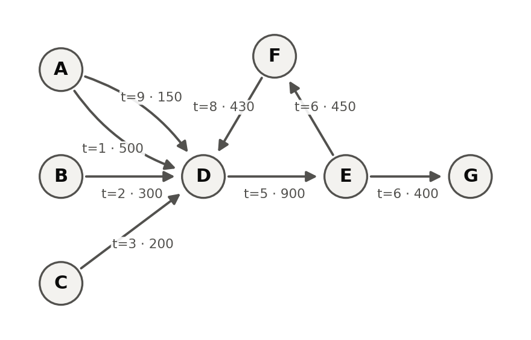
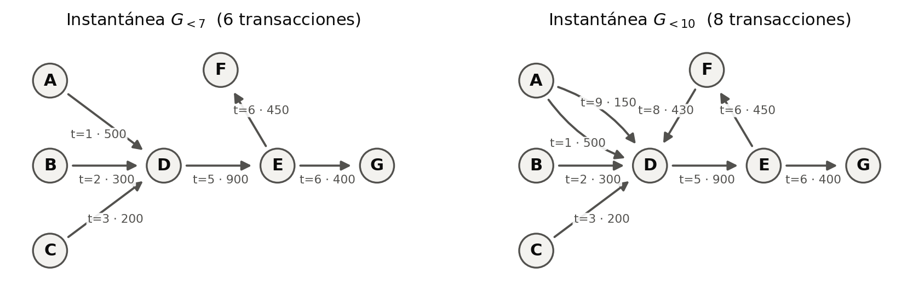
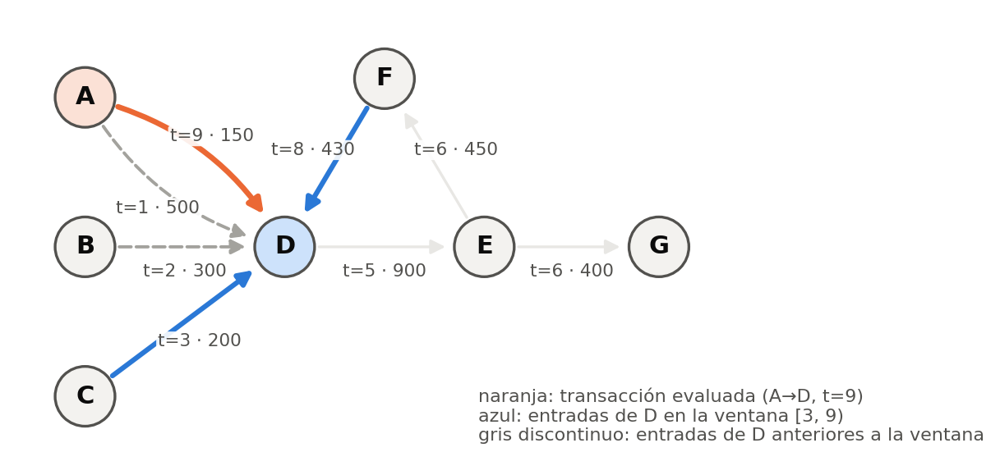
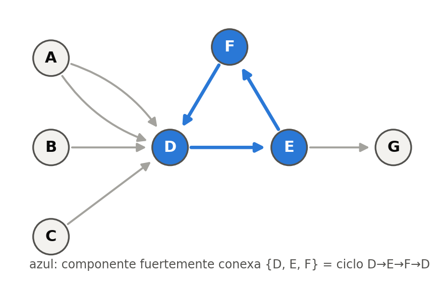
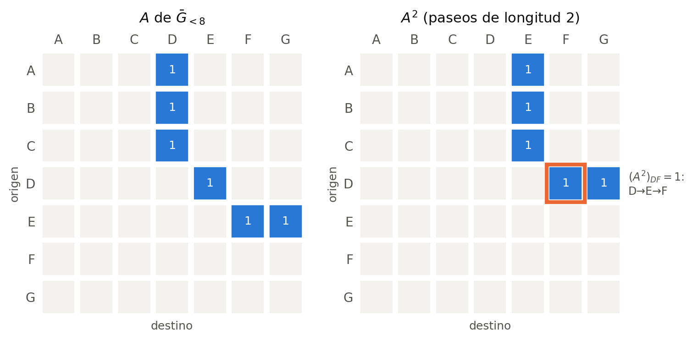
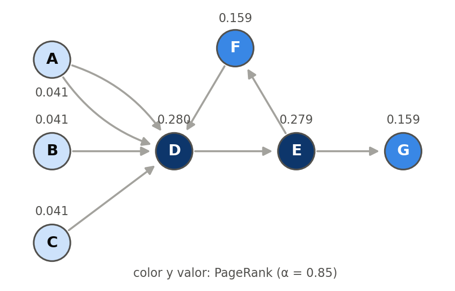
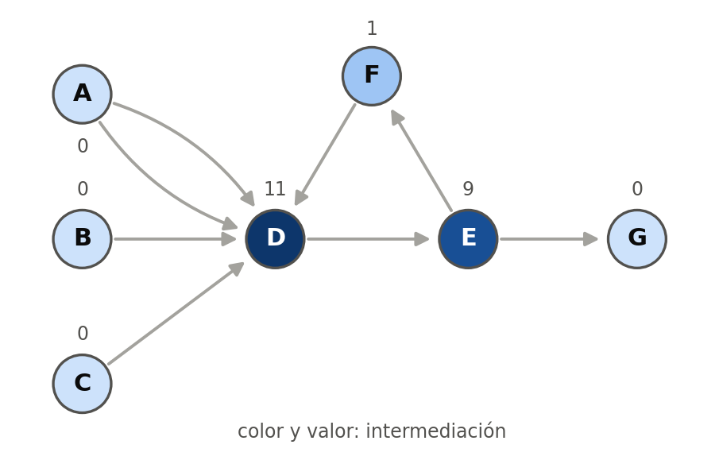
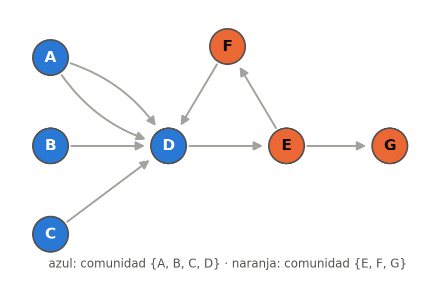
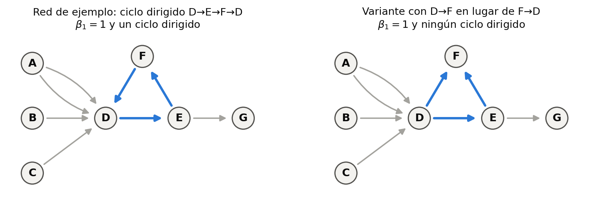
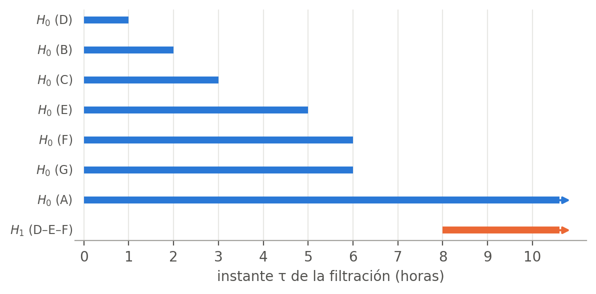

# 2. Marco teórico

El capítulo tiene tres partes. Primero se fijan las definiciones matemáticas: los grafos dirigidos temporales y la noción de causalidad (2.1), las métricas topológicas (2.2), los elementos del análisis topológico de datos que se usan o se descartan (2.3) y la detección de fraude como clasificación desbalanceada, con sus métricas de evaluación (2.4). Después se sintetiza lo que se sabe sobre el uso de grafos para detectar fraude y lavado, incluida la evidencia publicada en IBM AML (2.5). Por último se identifica el vacío que motiva la tesis, se presenta un marco explicativo y se formulan las hipótesis rivales que el diseño debe descartar (2.6).

## 2.1 Preliminares: grafos dirigidos temporales

Esta sección fija la notación y las definiciones que se usan en el resto de la tesis. Se sigue, salvo indicación, la terminología de Bang-Jensen y Gutin (2009) para grafos dirigidos, de Newman (2010) para redes y de Holme y Saramäki (2012) para redes temporales. Las definiciones están numeradas para poder referirlas desde los capítulos siguientes.

Para hacer concretas las definiciones, todas se ilustran sobre **una misma red de ejemplo**: siete cuentas (A a G) y ocho transacciones. La red está construida para contener las estructuras que interesan en esta tesis: varias cuentas que pagan a una misma (A, B, C y F hacia D), una cuenta que paga a varias (E hacia F y G), un ciclo (D→E→F→D) y una pareja de cuentas que repite transacción (A→D). Los valores de los ejemplos se calcularon con igraph mediante el script `docs/herramientas/figuras_marco.py`, que también genera las figuras.

### 2.1.1 Grafos dirigidos y multigrafos

**Definición 2.1 (grafo dirigido).** Un *grafo dirigido* es un par $`G = (V, E)`$, donde $`V`$ es un conjunto finito de *nodos* y $`E \subseteq V \times V`$ un conjunto de *aristas*. Cada arista es un par ordenado $`(u, v)`$, que se escribe $`u \to v`$; $`u`$ es su *origen* y $`v`$ su *destino*. Una arista $`(v, v)`$ se llama *lazo*. Un grafo dirigido es *simple* si no tiene lazos.

**Definición 2.2 (multigrafo dirigido ponderado).** Un *multigrafo dirigido ponderado* es una terna $`G = (V, E, w)`$, donde $`E`$ es un multiconjunto finito de pares ordenados de $`V \times V`$ y $`w : E \to \mathbb{R}_{\gt 0}`$ asigna un peso a cada arista. La *multiplicidad* $`m(u, v)`$ es el número de aristas $`u \to v`$ en $`E`$.

**Definición 2.3 (grafo temporal de transacciones).** Un *grafo temporal de transacciones* es un par $`\mathcal{G} = (V, \mathcal{E})`$, donde $`\mathcal{E}`$ es una sucesión finita de transacciones $`e_i = (u_i, v_i, t_i, w_i)`$, $`i = 1, \dots, N`$, con origen $`u_i \in V`$, destino $`v_i \in V`$, instante $`t_i \in \mathbb{R}`$ y monto $`w_i \gt  0`$ (Holme y Saramäki, 2012). Se define el **orden de las transacciones** $`e_j \prec e_i`$ si $`t_j \lt  t_i`$, o si $`t_j = t_i`$ y $`j \lt  i`$. Así, $`\prec`$ es un orden total que refleja la secuencia en que se registran las transacciones.

**Ejemplo 2.1 (la red de ejemplo).** La Figura 2.1 muestra la red. Sus transacciones, ordenadas por $`\prec`$, son $`e_1 = (A, D, 1, 500)`$, $`e_2 = (B, D, 2, 300)`$, $`e_3 = (C, D, 3, 200)`$, $`e_4 = (D, E, 5, 900)`$, $`e_5 = (E, F, 6, 450)`$, $`e_6 = (E, G, 6, 400)`$, $`e_7 = (F, D, 8, 430)`$ y $`e_8 = (A, D, 9, 150)`$, con el instante en horas y el monto en unidades monetarias. El conjunto de nodos es $`V = \{A, \dots, G\}`$. Como A paga dos veces a D, el multigrafo tiene multiplicidad $`m(A, D) = 2`$; las demás parejas tienen multiplicidad 1 y no hay lazos. Las transacciones $`e_5`$ y $`e_6`$ ocurren en el mismo instante, y el orden $`\prec`$ las desempata por su posición en el registro.



**Figura 2.1.** Red de ejemplo. Cada arista es una transacción, rotulada con su instante $`t`$ (en horas) y su monto.

**Definición 2.4 (instantánea).** Dado un instante $`\tau`$, la *instantánea* hasta $`\tau`$ es el multigrafo

```math
G_{<\tau} = \big(V,\ \{\!\{(u_j, v_j) : t_j < \tau\}\!\},\ w\big),
```

formado por todas las transacciones anteriores a $`\tau`$. Su *versión simple* $`\bar{G}_{\lt \tau} = (V, \bar{E}_{\lt \tau})`$ conserva una sola arista por par y elimina los lazos:

```math
\bar{E}_{<\tau} = \{(u, v) : u \neq v,\ \exists j,\ (u_j, v_j) = (u, v),\ t_j < \tau\}.
```

En esta tesis las métricas de PaySim se calculan sobre $`G_{\lt \tau}`$ y las de IBM AML sobre $`\bar{G}_{\lt \tau}`$ (3.4.3).

**Ejemplo 2.2 (instantáneas).** En la red de ejemplo, la instantánea $`G_{\lt 7}`$ contiene las seis primeras transacciones y $`G_{\lt 10}`$, las ocho (Figura 2.2). El ciclo D→E→F→D aún no existe en $`G_{\lt 7}`$: aparece con $`e_7`$, en $`t = 8`$. La versión simple $`\bar{G}_{\lt 10}`$ tiene siete aristas, porque las dos transacciones A→D se reducen a una.



**Figura 2.2.** Instantáneas de la red de ejemplo antes y después de que se cierre el ciclo D→E→F→D.

**Definición 2.5 (variable causal).** Sea $`\mathcal{H}_{\prec e} = \{e_j : e_j \prec e\}`$ la *historia* de la transacción $`e`$. Una variable $`f`$ es *causal* si existe una función $`\varphi`$ tal que, para toda transacción $`e`$,

```math
f(e) = \varphi\big(e,\ \mathcal{H}_{\prec e}\big),
```

es decir, si su valor depende solo de la propia transacción y de las anteriores. En particular, una variable calculada sobre una instantánea $`G_{\lt \tau}`$ con $`\tau \le t_e`$ es causal.

La causalidad es el requisito que evita la fuga de información (2.4.2). Una métrica calculada sobre el grafo completo $`G_{\lt \infty}`$ no es causal, porque incorpora transacciones posteriores a $`e`$.

**Ejemplo 2.3 (fuga de información en un grafo).** Supóngase que se quiere marcar las transacciones de las cuentas que pertenecen a un ciclo. Si la pertenencia se calcula sobre el grafo completo $`G_{\lt \infty}`$, la transacción $`e_4 = (D, E, 5, 900)`$ queda marcada, aunque en $`t = 5`$ ese ciclo no existía: se completa con $`e_7`$, tres horas después. Calculada sobre $`G_{\lt 5}`$, que solo contiene $`e_1`$, $`e_2`$ y $`e_3`$, la misma variable vale 0. La primera versión usa información del futuro; la segunda es causal.

### 2.1.2 Grado, fuerza y vecindarios

**Definición 2.6 (grado y fuerza).** En un multigrafo $`G = (V, E, w)`$, el *grado de salida* y el *grado de entrada* de un nodo $`v`$ son

```math
d^{out}(v) = \sum_{x \in V} m(v, x), \qquad d^{in}(v) = \sum_{x \in V} m(x, v),
```

y las *fuerzas* de salida y de entrada son las sumas de los pesos correspondientes:

```math
s^{out}(v) = \sum_{e = (v, x) \in E} w(e), \qquad s^{in}(v) = \sum_{e = (x, v) \in E} w(e).
```

**Definición 2.7 (contadores causales).** Para una transacción $`e = (u, v, t, w)`$ y una ventana $`\Delta \gt  0`$ se definen:

- *Grado previo de salida del origen*: $`d^{out}_{\prec e}(u) = |\{e_j \prec e : u_j = u\}|`$, y análogamente $`d^{in}_{\prec e}`$ y los grados del destino.
- ***Fan-out*** del origen en la ventana $`\Delta`$: $`F^{out}_{\Delta}(e) = |\{e_j : u_j = u,\ t - \Delta \le t_j \lt  t\}|`$. El ***fan-in*** del destino $`F^{in}_{\Delta}(e)`$ se define de forma simétrica con $`v_j = v`$.
- *Repetición del par*: $`r(e) = |\{e_j \prec e : (u_j, v_j) = (u, v)\}|`$.
- *Arista inversa previa*: $`\rho(e) = \mathbb{1}\big[\exists j : (u_j, v_j) = (v, u),\ t_j \lt  t\big]`$.
- *Tiempo desde la última transacción del origen*: $`g(e) = t - \max\{t_j : e_j \prec e,\ u_j = u\}`$, con $`g(e) = -1`$ si el conjunto es vacío.

Todas cumplen la Definición 2.5. En IBM AML se usa $`\Delta = 24`$ horas.

**Ejemplo 2.4 (grados y contadores causales).** En la red completa, D tiene grado de entrada $`d^{in}(D) = 5`$ (la pareja A→D cuenta dos veces), grado de salida $`d^{out}(D) = 1`$ y fuerza de entrada $`s^{in}(D) = 1\,580`$. Los contadores causales de la última transacción, $`e_8 = (A, D, 9, 150)`$, usan solo las siete anteriores (Figura 2.3):

- el grado previo de entrada de D es $`d^{in}_{\prec e_8}(D) = 4`$;
- con $`\Delta = 6`$ horas, el *fan-in* de D cuenta las entradas en el intervalo $`[3, 9)`$: $`F^{in}_{6}(e_8) = 2`$ ($`e_3`$ y $`e_7`$);
- la repetición del par es $`r(e_8) = 1`$, porque A ya había pagado a D;
- la arista inversa previa es $`\rho(e_8) = 0`$, porque D nunca pagó a A;
- el tiempo desde la última transacción de A es $`g(e_8) = 9 - 1 = 8`$ horas.



**Figura 2.3.** Contadores causales de la transacción $`e_8`$ (A→D, $`t = 9`$). Solo cuentan las transacciones anteriores, y el *fan-in* solo las de la ventana de seis horas.

**Definición 2.8 (vecindarios).** En un grafo dirigido simple, los *vecindarios de salida y de entrada* de $`v`$ son $`N^{+}(v) = \{x : (v, x) \in E\}`$ y $`N^{-}(v) = \{x : (x, v) \in E\}`$. El *vecindario de salida a distancia* $`k`$, $`N^{+}_k(v)`$, es el conjunto de nodos $`x \neq v`$ alcanzables desde $`v`$ por un camino de longitud a lo sumo $`k`$ (Definición 2.9); $`N^{-}_k(v)`$ se define de forma análoga.

**Ejemplo 2.5 (vecindarios).** En la versión simple de la red completa, $`N^{+}(E) = \{F, G\}`$, $`N^{-}(D) = \{A, B, C, F\}`$ y $`N^{+}_2(D) = \{E, F, G\}`$: desde D se llega a E en un paso, y a F y G en dos.

### 2.1.3 Caminos, ciclos y componentes

**Definición 2.9 (paseo, camino y ciclo).** En un grafo dirigido $`G = (V, E)`$:

- Un *paseo* de longitud $`k`$ es una sucesión de nodos $`(x_0, x_1, \dots, x_k)`$ con $`(x_{i-1}, x_i) \in E`$ para $`i = 1, \dots, k`$.
- Un *camino* es un paseo sin nodos repetidos.
- Un *ciclo dirigido* de longitud $`k \ge 2`$ es un paseo con $`x_0 = x_k`$ y $`x_0, \dots, x_{k-1}`$ distintos.
- Se dice que $`y`$ es *alcanzable* desde $`x`$, y se escribe $`x \rightsquigarrow y`$, si existe un camino de $`x`$ a $`y`$.
- La *distancia* $`\operatorname{dist}(x, y)`$ es la longitud del camino más corto de $`x`$ a $`y`$, o $`\infty`$ si $`y`$ no es alcanzable desde $`x`$.

**Definición 2.10 (componentes).** La relación $`x \sim y \iff (x \rightsquigarrow y \ \wedge\ y \rightsquigarrow x)`$, junto con $`x \sim x`$, es de equivalencia. Sus clases son las *componentes fuertemente conexas*. Las *componentes débilmente conexas* son las componentes conexas del grafo no dirigido subyacente, que se obtiene ignorando la dirección de las aristas.

**Proposición 2.1.** En un grafo dirigido simple, un nodo pertenece a algún ciclo dirigido si y solo si su componente fuertemente conexa tiene más de un nodo. En consecuencia, el grafo es *acíclico* (no contiene ciclos dirigidos) si y solo si todas sus componentes fuertemente conexas son unitarias (Bang-Jensen y Gutin, 2009).

*Demostración.* Si $`x`$ está en un ciclo $`(x = x_0, \dots, x_k = x)`$, entonces $`x \rightsquigarrow x_1`$ y $`x_1 \rightsquigarrow x`$, de modo que $`x \sim x_1`$ con $`x_1 \neq x`$. Recíprocamente, si $`x \sim y`$ con $`y \neq x`$, concatenar un camino de $`x`$ a $`y`$ con uno de $`y`$ a $`x`$ da un paseo cerrado que pasa por $`x`$. Todo paseo cerrado contiene un ciclo, y basta tomar el paseo cerrado más corto que pase por $`x`$ para obtener un ciclo que contiene a $`x`$. $`\square`$

Esta proposición justifica que la pertenencia a ciclos se calcule mediante componentes fuertemente conexas. Estas se obtienen en tiempo lineal $`O(|V| + |E|)`$ con el algoritmo de Tarjan (1972).

**Ejemplo 2.6 (caminos, ciclos y componentes).** En la red de ejemplo, $`(A, D, E, G)`$ es un camino de longitud 3 y $`\operatorname{dist}(A, G) = 3`$. El paseo $`(D, E, F, D)`$ es un ciclo dirigido de longitud 3. Por la Proposición 2.1, la única componente fuertemente conexa con más de un nodo es $`\{D, E, F\}`$; las otras cuatro cuentas forman componentes unitarias (Figura 2.4). En cambio, hay una sola componente débilmente conexa, que contiene a las siete cuentas. A, B y C no pertenecen a ningún ciclo: el dinero sale de ellas y no regresa.



**Figura 2.4.** Componentes de la red de ejemplo. En azul, la componente fuertemente conexa $`\{D, E, F\}`$, que coincide con el ciclo D→E→F→D.

### 2.1.4 Matriz de adyacencia y ciclos cortos

**Definición 2.11 (matriz de adyacencia).** La *matriz de adyacencia* de un grafo dirigido simple $`G = (V, E)`$, con $`V = \{1, \dots, n\}`$, es la matriz $`A \in \{0, 1\}^{n \times n}`$ con $`A_{xy} = 1`$ si $`(x, y) \in E`$ y $`A_{xy} = 0`$ en otro caso.

**Proposición 2.2.** Para todo $`k \ge 1`$, $`(A^k)_{xy}`$ es el número de paseos de longitud $`k`$ de $`x`$ a $`y`$ (Newman, 2010).

*Demostración.* Por inducción sobre $`k`$. El caso $`k = 1`$ es la definición. Si vale para $`k`$, entonces $`(A^{k+1})_{xy} = \sum_{z} (A^{k})_{xz} A_{zy}`$, que suma, sobre cada nodo $`z`$ con arista $`z \to y`$, el número de paseos de longitud $`k`$ de $`x`$ a $`z`$. $`\square`$

**Corolario 2.1 (cierre de ciclo de longitud 3).** Sea $`e = (u, v, t, w)`$ con $`u \neq v`$ y sea $`A`$ la matriz de adyacencia de la versión simple de la instantánea, $`\bar{G}_{\lt \tau}`$. Si $`(A^2)_{vu} \gt  0`$, existe un nodo $`z`$ con $`v \to z \to u`$. Como $`\bar{G}_{\lt \tau}`$ no tiene lazos, $`z \neq u`$ y $`z \neq v`$, y la transacción $`e`$ cierra el ciclo dirigido $`(u, v, z, u)`$ de longitud 3. La variable `closes_3cycle` de IBM AML es la indicadora $`\mathbb{1}[(A^2)_{vu} \gt  0]`$. La arista inversa previa $`\rho(e)`$ de la Definición 2.7 es el análogo de longitud 2, $`\mathbb{1}[A_{vu} \gt  0]`$, pero se evalúa sobre toda la historia anterior a $`t`$ y no sobre la instantánea, por lo que no tiene rezago.

**Ejemplo 2.7 (cierre de un ciclo de longitud 3).** La transacción $`e_7 = (F, D, 8, 430)`$ tiene $`u = F`$ y $`v = D`$, y su instantánea $`\bar{G}_{\lt 8}`$ contiene D→E y E→F. En la Figura 2.5, la fila D de $`A^2`$ tiene un 1 en la columna F: $`(A^2)_{DF} = 1`$, que corresponde al paseo D→E→F. Por el Corolario 2.1, $`e_7`$ cierra el ciclo $`(F, D, E, F)`$ y su variable `closes_3cycle` vale 1. En cambio, su arista inversa previa vale 0, porque D nunca había pagado directamente a F.



**Figura 2.5.** Matriz de adyacencia $`A`$ de la instantánea $`\bar{G}_{\lt 8}`$ y su cuadrado. La celda resaltada indica que hay un paseo de longitud 2 de D a F, de modo que la transacción F→D cierra un ciclo.

## 2.2 Métricas topológicas

Las métricas topológicas resumen la posición y el entorno de un nodo en el grafo. Se agrupan según el alcance de la información que usan: las **locales** (2.2.1) dependen del vecindario inmediato del nodo, y las **globales** (2.2.2 a 2.2.5) dependen de todo el grafo.

### 2.2.1 Métricas locales

El grado y la fuerza (Definición 2.6) miden la actividad de un nodo. Restringidos a una ventana reciente se obtienen el *fan-in* y el *fan-out* (Definición 2.7). Un destino que recibe de muchos orígenes en poco tiempo es un punto de concentración de fondos, propiedad esperada tanto en comercios legítimos como en cuentas recolectoras de lavado. Por eso el grado por sí solo no basta: su valor diagnóstico depende de cómo se compare con el comportamiento legítimo.

**Definición 2.12 (coeficiente de agrupamiento local).** En un grafo no dirigido simple, sea $`k_v`$ el grado de $`v`$ y $`T(v)`$ el número de triángulos que contienen a $`v`$. El *coeficiente de agrupamiento local* es

```math
C(v) = \frac{2\,T(v)}{k_v (k_v - 1)} \quad \text{si } k_v \ge 2, \qquad C(v) = 0 \text{ en otro caso}.
```

Mide qué fracción de los pares de vecinos de $`v`$ están conectados entre sí (Watts y Strogatz, 1998).

**Definición 2.13 (núcleo-$`k`$ y número de núcleo).** En un grafo no dirigido, el *núcleo-*$`k`$ es el subgrafo inducido maximal en el que todo nodo tiene grado al menos $`k`$. El *número de núcleo* de $`v`$ es el mayor $`k`$ tal que $`v`$ pertenece al núcleo-$`k`$ (Seidman, 1983). Se calcula en tiempo $`O(|E|)`$ eliminando sucesivamente los nodos de menor grado (Batagelj y Zaveršnik, 2003).

**Ejemplo 2.8 (agrupamiento y núcleos).** En el grafo no dirigido de la red de ejemplo, D tiene cinco vecinos (A, B, C, E y F) y participa en un solo triángulo, D–E–F, de modo que $`C(D) = 2 \cdot 1 / (5 \cdot 4) = 0.1`$. E tiene tres vecinos y el mismo triángulo, así que $`C(E) = 1/3`$. F, cuyos dos vecinos están conectados entre sí, tiene $`C(F) = 1`$. El núcleo-2 es el triángulo $`\{D, E, F\}`$, cuyos nodos tienen número de núcleo 2; el resto tiene número de núcleo 1.

La repetición del par $`r(e)`$ y la arista inversa previa $`\rho(e)`$ (Definición 2.7) son también locales. Capturan la *memoria relacional* de una pareja de cuentas: las relaciones legítimas tienden a repetirse, mientras que un patrón de lavado puede usar contrapartes nuevas.

### 2.2.2 PageRank

**Definición 2.14 (PageRank).** Sea $`G = (V, E)`$ un multigrafo dirigido con $`n = |V|`$ nodos y sea $`D = \{x : d^{out}(x) = 0\}`$ el conjunto de *nodos colgantes*. Para $`\alpha \in (0, 1)`$, el vector PageRank $`\pi \in \mathbb{R}^n`$ es la única solución con $`\pi \ge 0`$ y $`\sum_v \pi_v = 1`$ de

```math
\pi_v = \frac{1 - \alpha}{n} + \alpha \left( \sum_{x \notin D} \frac{m(x, v)}{d^{out}(x)}\, \pi_x + \frac{1}{n} \sum_{x \in D} \pi_x \right)
```

(Page et al., 1999; Langville y Meyer, 2006).

Es la distribución estacionaria de un paseo aleatorio que, en cada paso, sigue una arista de salida con probabilidad $`\alpha`$ (eligiéndola en proporción a su multiplicidad) o salta a un nodo uniforme con probabilidad $`1 - \alpha`$. Desde los nodos colgantes salta siempre de forma uniforme. A diferencia del grado, el PageRank de $`v`$ depende de la importancia de quienes le envían fondos. Se usa $`\alpha = 0.85`$.

**Ejemplo 2.9 (PageRank).** La Figura 2.6 muestra el PageRank de cada cuenta. D (0.280) y E (0.279) tienen los valores más altos, aunque sus grados de entrada son muy distintos: D recibe de cuatro cuentas y E solo de D. E hereda la importancia de D, y eso es lo que distingue al PageRank del grado. A, B y C, que no reciben fondos, solo obtienen la parte del salto uniforme y la que redistribuye G, la cuenta sin salidas (0.041 cada una).



**Figura 2.6.** PageRank de cada cuenta de la red de ejemplo ($`\alpha = 0.85`$). Un color más oscuro indica un valor más alto.

### 2.2.3 Intermediación

**Definición 2.15 (intermediación).** En un grafo dirigido simple, sea $`\sigma_{st}`$ el número de caminos de longitud mínima de $`s`$ a $`t`$ y $`\sigma_{st}(v)`$ el número de ellos que pasan por $`v`$. La *intermediación* de $`v`$ es

```math
C_B(v) = \sum_{\substack{s, t \in V \\ s \neq v \neq t,\ s \neq t}} \frac{\sigma_{st}(v)}{\sigma_{st}},
```

con el convenio $`0/0 = 0`$ (Freeman, 1977). La *intermediación restringida a longitud* $`L`$ solo considera los pares a distancia acotada:

```math
C_B^{(L)}(v) = \sum_{\substack{s \neq v \neq t \\ \operatorname{dist}(s, t) \le L}} \frac{\sigma_{st}(v)}{\sigma_{st}}.
```

La intermediación identifica nodos por los que transita el dinero. Si $`d^{in}(v) = 0`$ o $`d^{out}(v) = 0`$, ningún camino puede atravesar $`v`$ y $`C_B(v) = 0`$. El algoritmo de Brandes (2001) la calcula en tiempo $`O(|V||E|)`$, lo que la hace inviable en grafos grandes y obliga a usar $`C_B^{(L)}`$. En esta tesis se usa $`L = 4`$ en IBM AML y Elliptic.

**Ejemplo 2.10 (intermediación).** En la red de ejemplo (Figura 2.7), D tiene intermediación 11: está en el único camino mínimo de A, B y C hacia E, F y G (nueve pares) y de F hacia E y G (dos pares). E tiene intermediación 9 y F, 1, porque está en el camino de E a D. A, B, C y G tienen intermediación 0, como anticipa la observación anterior: las tres primeras no reciben fondos y G no los envía.



**Figura 2.7.** Intermediación de cada cuenta de la red de ejemplo.

### 2.2.4 Comunidades y modularidad

**Definición 2.16 (modularidad).** Sea $`H`$ un grafo no dirigido con matriz de adyacencia $`B`$, grados $`k_x`$ y $`M`$ aristas. Para una partición de los nodos en comunidades, con $`c_x`$ la comunidad de $`x`$, la *modularidad* es

```math
Q = \frac{1}{2M} \sum_{x, y} \left( B_{xy} - \frac{k_x k_y}{2M} \right) \delta(c_x, c_y),
```

donde $`\delta`$ es la delta de Kronecker (Newman y Girvan, 2004).

$`Q`$ compara la densidad de aristas dentro de las comunidades con la esperada si las aristas se distribuyeran al azar conservando los grados. El **método de Louvain** (Blondel et al., 2008) busca una partición de modularidad alta en dos fases que se repiten: primero mueve cada nodo a la comunidad vecina que más aumenta $`Q`$, y luego agrega cada comunidad en un solo nodo. En esta tesis se aplica sobre el grafo no dirigido subyacente, y la variable usada es el tamaño de la comunidad de cada nodo.

**Ejemplo 2.11 (comunidades).** Louvain divide la red de ejemplo en dos comunidades, $`\{A, B, C, D\}`$ y $`\{E, F, G\}`$, con modularidad $`Q = 0.204`$ (Figura 2.8). La primera agrupa la concentración de fondos hacia D y la segunda, su dispersión desde E. Solo dos transacciones conectan ambas comunidades: D→E y F→D.



**Figura 2.8.** Comunidades de Louvain en la red de ejemplo.

### 2.2.5 Componentes y ciclos

El tamaño de la componente débilmente conexa y el de la componente fuertemente conexa de un nodo (Definición 2.10) son métricas globales. Por la Proposición 2.1, que la componente fuerte tenga más de un nodo equivale a pertenecer a un ciclo dirigido. Los ciclos son el indicador clásico de la etapa de estratificación del lavado, en la que los fondos circulan entre cuentas para ocultar su origen (Akoglu et al., 2015). Los ciclos de longitud 2 y 3 se detectan además por transacción, con el Corolario 2.1.

## 2.3 Análisis topológico de datos

El análisis topológico de datos estudia la "forma" de un conjunto de datos mediante invariantes algebraicos que no cambian bajo deformaciones continuas (Carlsson, 2009). Esta sección define lo necesario para precisar qué parte de esa teoría usa la tesis y qué parte queda como trabajo futuro.

**Definición 2.17 (complejo simplicial).** Un *complejo simplicial abstracto* $`K`$ sobre un conjunto finito $`V`$ es una familia de subconjuntos no vacíos de $`V`$, llamados *símplices*, cerrada bajo subconjuntos: si $`\sigma \in K`$ y $`\emptyset \neq \eta \subseteq \sigma`$, entonces $`\eta \in K`$. Un símplice con $`p + 1`$ elementos tiene *dimensión* $`p`$. Un grafo no dirigido simple es un complejo de dimensión 1: sus nodos son los 0-símplices y sus aristas, los 1-símplices.

**Definición 2.18 (homología y números de Betti).** Sea $`C_p(K)`$ el espacio vectorial sobre $`\mathbb{F}_2`$ generado por los $`p`$-símplices de $`K`$, y sea $`\partial_p : C_p \to C_{p-1}`$ el operador borde, que envía cada símplice a la suma de sus caras de dimensión $`p - 1`$. El $`p`$-ésimo *grupo de homología* es $`H_p(K) = \ker \partial_p / \operatorname{im} \partial_{p+1}`$, y el $`p`$-ésimo *número de Betti* es $`\beta_p = \dim H_p(K)`$ (Edelsbrunner y Harer, 2010). Intuitivamente, $`\beta_0`$ cuenta las componentes conexas, $`\beta_1`$ los ciclos independientes y $`\beta_2`$ las cavidades.

**Proposición 2.3.** Para un grafo no dirigido simple $`H = (V, E)`$ con $`c`$ componentes conexas,

```math
\beta_0(H) = c, \qquad \beta_1(H) = |E| - |V| + c.
```

*Demostración.* $`\beta_0 = c`$ porque $`H_0`$ tiene una clase por componente. Por la fórmula de Euler-Poincaré, la característica de Euler cumple $`\chi = |V| - |E| = \beta_0 - \beta_1`$, ya que no hay símplices de dimensión mayor que 1. Despejando se obtiene $`\beta_1`$. $`\square`$

Una precisión es importante para esta tesis. **$`\beta_1`$ cuenta los ciclos del grafo *no dirigido* subyacente, no los ciclos dirigidos.** Un grafo dirigido acíclico puede tener $`\beta_1 \gt  0`$: por ejemplo, las aristas $`a \to b`$, $`a \to c`$ y $`b \to c`$ forman un ciclo no dirigido pero ninguno dirigido. Las variables de ciclos de esta tesis (Proposición 2.1 y Corolario 2.1) son, por tanto, un **refinamiento dirigido** que $`\beta_1`$ no captura. Solo el tamaño de la componente débil está directamente relacionado con $`H_0`$. Los valores de $`\beta_0`$ y $`\beta_1`$ de cada grafo estudiado se reportan como descripción en el Capítulo 4 (Tablas 4.1 y 4.5).

**Ejemplo 2.12 (números de Betti).** El grafo no dirigido de la red de ejemplo tiene siete nodos, siete aristas (las dos transacciones A→D forman una sola) y una componente, de modo que, por la Proposición 2.3, $`\beta_0 = 1`$ y $`\beta_1 = 7 - 7 + 1 = 1`$: el único ciclo es el triángulo D–E–F. Si la transacción F→D se reemplaza por D→F (Figura 2.9), $`\beta_1`$ sigue valiendo 1, pero el grafo dirigido ya no tiene ciclos: el dinero de D llega a F por dos rutas y nunca vuelve a D.



**Figura 2.9.** Ciclo dirigido frente a ciclo no dirigido. Ambas redes tienen $`\beta_1 = 1`$, pero solo la de la izquierda contiene un ciclo dirigido.

**Definición 2.19 (filtración y homología persistente).** Una *filtración* de un complejo $`K`$ es una sucesión creciente de subcomplejos $`\emptyset = K_0 \subseteq K_1 \subseteq \cdots \subseteq K_m = K`$. Las inclusiones inducen aplicaciones lineales $`H_p(K_i) \to H_p(K_j)`$ para $`i \le j`$. La *homología persistente* registra, para cada clase de homología, el índice $`b`$ en que aparece y el índice $`d`$ en que deja de existir. El resultado es un multiconjunto de pares $`(b, d)`$, el *diagrama de persistencia* o *código de barras* (Zomorodian y Carlsson, 2005; Edelsbrunner y Harer, 2010). Las clases con $`d - b`$ grande se interpretan como estructura y las de vida corta, como ruido.

Para un grafo temporal, una filtración natural es la sucesión de instantáneas $`\bar{G}_{\lt \tau_1} \subseteq \bar{G}_{\lt \tau_2} \subseteq \cdots`$, vistas como complejos de dimensión 1. Su persistencia describiría cuándo aparecen y se fusionan componentes y cuándo se forman ciclos. Esta tesis no calcula diagramas de persistencia, y su uso como variables se propone como trabajo futuro (6.4).

**Ejemplo 2.13 (persistencia en el tiempo).** Si se toma como filtración la sucesión de instantáneas de la red de ejemplo, al inicio hay siete componentes, una por cuenta. Cada transacción que une dos componentes hace desaparecer una, en los instantes 1, 2, 3, 5, 6 y 6, hasta quedar una sola que persiste (barras azules de la Figura 2.10). En $`t = 8`$, la transacción F→D cierra el triángulo y nace una clase de $`H_1`$ que persiste hasta el final (barra naranja). La transacción repetida A→D de $`t = 9`$ no modifica la homología. En este lenguaje, el ciclo de la red es una característica persistente de dimensión 1 que nace en $`t = 8`$.



**Figura 2.10.** Código de barras de la filtración por tiempo de la red de ejemplo. Cada barra azul es una componente ($`H_0`$) y la naranja, el ciclo ($`H_1`$); las flechas indican clases que persisten. Cuando se unen dos componentes nacidas a la vez, se da por desaparecida la de la cuenta con letra posterior.

## 2.4 Detección de fraude como clasificación desbalanceada

### 2.4.1 Planteamiento y métricas

Se dispone de transacciones $`e_i`$ con etiqueta $`y_i \in \{0, 1\}`$ ($`y_i = 1`$ si es ilícita) y de un clasificador que asigna un puntaje $`s_i \in [0, 1]`$. Dado un umbral $`\theta`$, la predicción es $`\hat{y}_i = \mathbb{1}[s_i \ge \theta]`$. Con $`\mathrm{TP}`$, $`\mathrm{FP}`$ y $`\mathrm{FN}`$ el número de verdaderos positivos, falsos positivos y falsos negativos, se definen (van Rijsbergen, 1979; Manning et al., 2008):

**Definición 2.20 (precisión, exhaustividad y $`F_1`$).**

```math
P(\theta) = \frac{\mathrm{TP}}{\mathrm{TP} + \mathrm{FP}}, \qquad R(\theta) = \frac{\mathrm{TP}}{\mathrm{TP} + \mathrm{FN}}, \qquad F_1(\theta) = \frac{2\,P R}{P + R} = \frac{2\,\mathrm{TP}}{2\,\mathrm{TP} + \mathrm{FP} + \mathrm{FN}}.
```

La precisión mide qué fracción de las alertas son fraude. La exhaustividad mide qué fracción del fraude se detecta. $`F_1`$ es su media armónica y no usa los verdaderos negativos, lo que la hace adecuada cuando estos son abrumadoramente mayoritarios.

**Definición 2.21 (PR-AUC).** Sean $`\theta_1 \gt  \theta_2 \gt  \cdots \gt  \theta_K`$ los valores distintos de los puntajes, y sean $`P_k`$ y $`R_k`$ la precisión y la exhaustividad con umbral $`\theta_k`$, con $`R_0 = 0`$. La *precisión promedio* es

```math
\mathrm{AP} = \sum_{k=1}^{K} (R_k - R_{k-1})\, P_k,
```

una aproximación escalonada del área bajo la curva precisión-exhaustividad (Manning et al., 2008). En esta tesis se denomina **PR-AUC**. A diferencia de $`F_1`$, no depende de un umbral. Para un clasificador aleatorio su valor esperado es la prevalencia $`\pi_1`$ de la clase positiva, que sirve de referencia.

**Definición 2.22 (ROC-AUC).** El área bajo la curva ROC es la probabilidad de que una transacción ilícita elegida al azar reciba un puntaje mayor que una legítima elegida al azar: $`\Pr(s^{+} \gt  s^{-})`$, contando los empates como 1/2.

**Ejemplo 2.14 (métricas de evaluación).** Cinco transacciones reciben los puntajes 0.9, 0.8, 0.7, 0.4 y 0.2, y solo la primera y la tercera son ilícitas. Con umbral $`\theta = 0.75`$ se alertan las dos primeras: $`\mathrm{TP} = 1`$, $`\mathrm{FP} = 1`$ y $`\mathrm{FN} = 1`$, de modo que $`P = R = F_1 = 0.5`$. Al recorrer los umbrales de mayor a menor, la exhaustividad sube a 0.5 con el primer puntaje (precisión 1) y a 1 con el tercero (precisión 2/3), así que $`\mathrm{AP} = 0.5 \cdot 1 + 0.5 \cdot 2/3 = 0.833`$. La ROC-AUC también vale 0.833: de los seis pares formados por una transacción ilícita y una legítima, en cinco la ilícita tiene el puntaje más alto. Como la prevalencia es 2/5, un clasificador aleatorio obtendría $`\mathrm{AP} \approx 0.4`$.

Con clases muy desbalanceadas, la ROC-AUC puede ser alta aunque la precisión sea baja, porque los falsos positivos se diluyen entre los numerosos verdaderos negativos. Por eso se prefieren $`F_1`$ y PR-AUC (Saito y Rehmsmeier, 2015).

### 2.4.2 Fuga de información

Una variable sufre *fuga de información* cuando contiene datos que no estarían disponibles al momento de la predicción o que codifican la etiqueta (Kaufman et al., 2012). En términos de la Definición 2.5, toda variable no causal es una fuente potencial de fuga. En grafos el riesgo es específico: una métrica calculada sobre $`G_{\lt \infty}`$ incorpora transacciones posteriores, incluidas las que completan el patrón de fraude que se quiere predecir.

### 2.4.3 Desbalance y validación temporal

El fraude es un evento raro (entre 0.05 % y 0.13 % de las transacciones en los conjuntos estudiados). Se usan ponderación de clases y submuestreo por árbol en lugar de sobremuestreo sintético (SMOTE; Chawla et al., 2002), para no generar transacciones artificiales en un espacio donde las variables de grafo no tienen una interpretación geométrica clara. Como las transacciones están ordenadas en el tiempo, la validación cruzada aleatoria permitiría al modelo "ver el futuro". Se usa una partición temporal.

### 2.4.4 *Random Forest*

*Random Forest* (Breiman, 2001) promedia las predicciones de $`B`$ árboles de decisión. Cada árbol se entrena sobre una muestra *bootstrap* de los datos y, en cada nodo, elige la mejor división entre un subconjunto aleatorio de variables. El puntaje de una transacción es la fracción promedio de votos para la clase positiva. Requiere poco ajuste, es robusto ante variables irrelevantes y permite medir la importancia de cada variable (reducción media de impureza), lo que lo hace adecuado para comparar grupos de variables.

## 2.5 Estado del conocimiento

La revisión se organiza en cuatro ideas: las estructuras de red como señal de fraude (2.5.1), la evidencia en el conjunto IBM AML (2.5.2), las formas de incorporar la red al modelo (2.5.3) y el riesgo de evaluar con datos sintéticos (2.5.4).

### 2.5.1 Las estructuras de red como señal de fraude

La literatura coincide en que el fraude organizado y el lavado de dinero dejan huellas estructurales. La revisión de Akoglu et al. (2015) agrupa los métodos de detección de anomalías en grafos según la señal que usan: la estructura local de cada nodo, la pertenencia a comunidades y la relación entre nodos conectados. La revisión sistemática de Pourhabibi et al. (2020), centrada en fraude, propone un marco de clasificación para los métodos de detección de anomalías basados en grafos publicados entre 2007 y 2018. En lavado de dinero, los patrones descritos de forma recurrente son el *fan-in*, el *fan-out*, las cadenas de intermediarios, las estructuras bipartitas y los ciclos; Altman et al. (2023) los formalizan como subgrafos en su generador de datos sintéticos.

La evidencia en datos reales apunta en la misma dirección, aunque con matices. En fraude con tarjetas de crédito, Van Vlasselaer et al. (2015) combinan variables intrínsecas de cada transacción y del historial del cliente (recencia, frecuencia y monto) con variables extraídas de la red de tarjetahabientes y comercios. Obtienen sus mejores resultados con *Random Forest* (AUC superior a 0.98) cuando usan ambos tipos y concluyen que la información intrínseca y la de red están estrechamente entrelazadas. En lavado de dinero, Starnini et al. (2021) detectan el *smurfing*, la división de grandes sumas en muchas transacciones pequeñas, buscando subgrafos sospechosos en un grafo de transacciones que evoluciona en el tiempo. Su evaluación usa una red bancaria real con más de 180 millones de transacciones. Cardoso et al. (2022), también con datos reales, reportan que representaciones aprendidas sobre el grafo cliente-transacción mejoran en 12 puntos de AUC al mejor modelo sin grafo. En cambio, en la red de Bitcoin etiquetada por Weber et al. (2019), las variables locales de cada transacción ya alcanzan un desempeño alto, y la información de vecinos y los modelos de grafos aportan mejoras que dependen del modelo y del periodo evaluado.

Dos observaciones se repiten en estos trabajos y son relevantes para esta tesis. La primera es que el **tiempo** forma parte de la señal: el *smurfing* se define por la concentración temporal de transacciones, y las variables de recencia de Van Vlasselaer et al. (2015) son temporales. La segunda es que **la magnitud de la mejora varía según los datos**, sin que exista un criterio explícito para anticipar cuándo será grande.

### 2.5.2 La evidencia en IBM AML

IBM AML (Altman et al., 2023) se ha convertido en una referencia para comparar métodos de detección de lavado basados en grafos, porque sus etiquetas son completas: el generador conoce todas las transacciones ilícitas, mientras que en datos reales muchas nunca se detectan. Sus autores y los de Egressy et al. (2024) evalúan modelos con la misma partición temporal 60/20/20 que usa esta tesis y reportan el $`F_1`$ de la clase minoritaria.

**Tabla 2.1.** $`F_1`$ de la clase minoritaria reportado en IBM AML Small (media ± desviación estándar, en %).

| Modelo | HI | LI | Fuente |
|---|---|---|---|
| GIN (red neuronal de grafos) | 28.70 ± 1.13 | 7.90 ± 2.78 | Altman et al. (2023) |
| PNA (red neuronal de grafos) | 56.77 ± 2.41 | 16.45 ± 1.46 | Altman et al. (2023) |
| LightGBM + variables de grafo | 62.86 ± 0.25 | 20.83 ± 1.50 | Altman et al. (2023) |
| XGBoost + variables de grafo | 63.23 ± 0.17 | 27.30 ± 0.33 | Altman et al. (2023) |
| Multi-PNA + EU (multigrafo dirigido) | 68.16 ± 2.65 | 33.07 ± 2.63 | Egressy et al. (2024) |

Las variables de grafo de los modelos de árboles cuentan los subgrafos sospechosos (ciclos, *fan-in*, *fan-out*, etc.) que contienen a cada transacción. Egressy et al. (2024) señalan que esas variables "se alinean perfectamente" con los patrones del simulador, y aun así su mejor red neuronal las supera. También documentan que la exhaustividad sobre las transacciones ilícitas que no pertenecen a ningún patrón es cercana a cero, y que esas transacciones son el 38 % del lavado en HI-Small y el 71 % en LI-Small. Altman et al. (2023) precisan que no usan los identificadores de cuenta como variables, para que el modelo no aprenda a reconocer cuentas concretas.

Dos aspectos quedan fuera de esos trabajos. Ninguno reporta un **modelo solo transaccional**, por lo que no permiten cuantificar cuánto aporta la red frente a no usarla. Tampoco examinan la composición temporal del conjunto, como la cola final con alta proporción de lavado que se documenta en esta tesis (4.5).

### 2.5.3 Variables manuales frente a aprendizaje sobre el grafo

Hay dos enfoques para usar la estructura. El primero calcula variables manuales (grados, centralidades, comunidades, conteo de subgrafos) y las entrega a un clasificador convencional (Van Vlasselaer et al., 2015; Altman et al., 2023). El segundo aprende la representación directamente sobre el grafo mediante redes neuronales de grafos (Weber et al., 2019; Cardoso et al., 2022; Egressy et al., 2024). El primero es más interpretable y permite atribuir la mejora a tipos concretos de información; el segundo puede ser más potente, como muestra la Tabla 2.1, pero hace difícil saber qué estructura usa el modelo. Esta tesis adopta el primer enfoque porque su pregunta es precisamente **qué tipo de información de red aporta**.

### 2.5.4 El riesgo de evaluar con datos sintéticos

Como los datos reales etiquetados rara vez son públicos, la investigación depende de simuladores como PaySim (Lopez-Rojas et al., 2016) o el generador de IBM AML (Altman et al., 2023). Un simulador reproduce las reglas con que fue construido: si el fraude se genera de un modo que lo hace identificable por un atributo individual, un clasificador puede aprender ese atajo en lugar del fenómeno de interés. Este riesgo de **aprendizaje por atajos** (*shortcut learning*) se ha documentado ampliamente en aprendizaje automático (Geirhos et al., 2020). Para los métodos de grafos tiene una forma adicional: un simulador puede no generar ninguna estructura de red, y en ese caso la conclusión de que la topología no ayuda dice más del simulador que del método.

## 2.6 Vacío, marco explicativo e hipótesis rivales

### 2.6.1 Vacío

De la revisión se desprenden tres constataciones:
1. existe consenso sobre los patrones estructurales del lavado;
2. la mejora atribuible a la información de red varía entre conjuntos de datos, sin un criterio explícito para anticiparla;
3. los conjuntos sintéticos que sirven de referencia pueden contener atajos o carecer de estructura.

En IBM AML, además, los trabajos publicados comparan modelos que ya usan la red, sin un modelo solo transaccional que permita medir cuánto aporta. Más en general, lo que no se encuentra en la literatura revisada es una evaluación que **relacione explícitamente la mejora atribuible a la topología con las propiedades estructurales del conjunto de datos** y que separe qué tipo de información de red (estructural local, temporal o global) explica esa mejora. Esa es la contribución que se propone esta tesis.

### 2.6.2 Marco explicativo

Se propone que la ganancia de las variables topológicas depende de dos condiciones:

1. **Que el fraude forme estructuras de red** (ciclos, cadenas, *fan-in*/*fan-out*) que el comportamiento legítimo no reproduzca en igual medida.
2. **Que el fraude no sea ya separable por atributos individuales.** Si lo es, el modelo de referencia alcanza el techo y no queda margen de mejora.

Cuando se cumplen ambas, se espera una mejora grande; cuando falla la primera, ninguna mejora; cuando falla la segunda, una mejora nula o incluso negativa. H1 (1.5) corresponde al caso en que se cumplen ambas condiciones. La inyección controlada (3.7.3) permite variar la primera de forma deliberada.

**Estatus del modelo.** Este marco se formuló después del Estudio 1, a partir de lo observado en PaySim, y se precisó al interpretar los resultados del Estudio 2. Por eso se usa como **marco explicativo** y no como una predicción contrastada: lo único que se fijó antes de los experimentos fue el criterio de H1 en IBM AML (3.7.2). Ponerlo a prueba de forma prospectiva, en conjuntos de datos no usados para formularlo, queda como trabajo futuro (6.4).

### 2.6.3 Hipótesis rivales

Una mejora observada al agregar variables topológicas podría explicarse por causas distintas de la estructura de red. El diseño (Capítulo 3) incluye un control para cada una, como resume la Tabla 2.2.

**Tabla 2.2.** Hipótesis rivales y su control.

| Rival | Explicación alternativa | Cómo se evalúa |
|---|---|---|
| **R1** Comportamiento temporal | La mejora se debe al ritmo temporal de las cuentas (tiempo entre transacciones), no a la estructura | Ablación que separa contadores estructurales y temporales (4.8.2) |
| **R2** Artefacto del generador | La mejora explota una regla del simulador, no un patrón de red | Caracterización de cada conjunto, búsqueda de atajos (4.2–4.3), recorte temporal en IBM y sensibilidad (4.7.2) |
| **R3** Fuga de información | Las variables contienen información del futuro o de la etiqueta | Variables causales verificadas por pruebas automatizadas (3.4.3) y ausencia de etiquetas en su cálculo |
| **R4** Más variables, más capacidad | Cualquier conjunto adicional de variables mejoraría el modelo | En PaySim, agregar topología no mejora; en IBM se compara cada grupo por separado y solo con topología (T4) |
| **R5** Azar de muestreo o de entrenamiento | La diferencia es ruido | *Bootstrap* pareado en prueba y tres semillas; *bootstrap* por semilla cuando la varianza lo exige |

### 2.6.4 Alcance teórico

El marco se limita a variables manuales calculadas sobre el grafo y a clasificadores convencionales. No aborda redes neuronales de grafos ni homología persistente sobre filtraciones. Supone, además, que las etiquetas de los conjuntos de datos son correctas y completas, lo que en los conjuntos sintéticos se cumple por construcción y en Elliptic solo para la fracción etiquetada de las transacciones.
