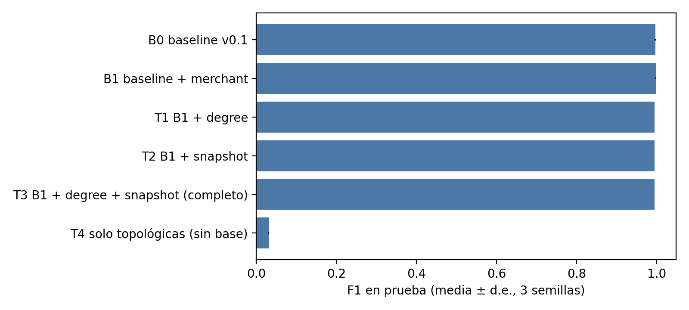
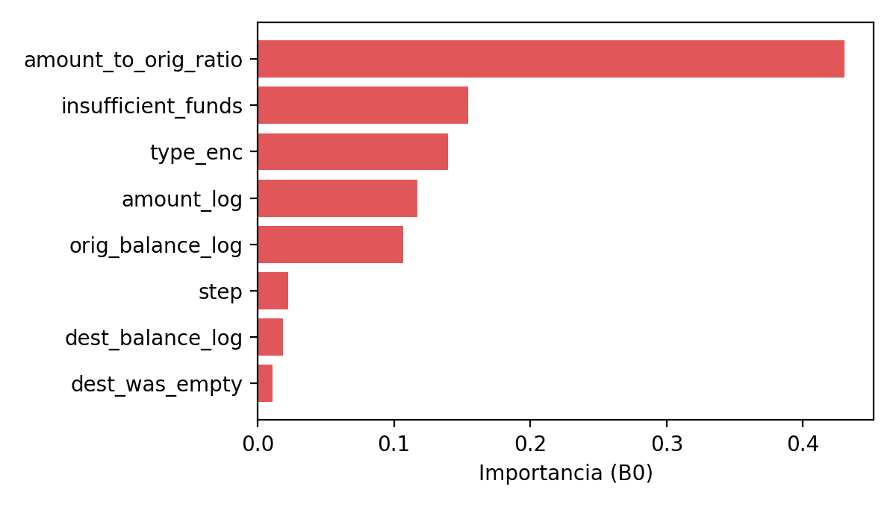
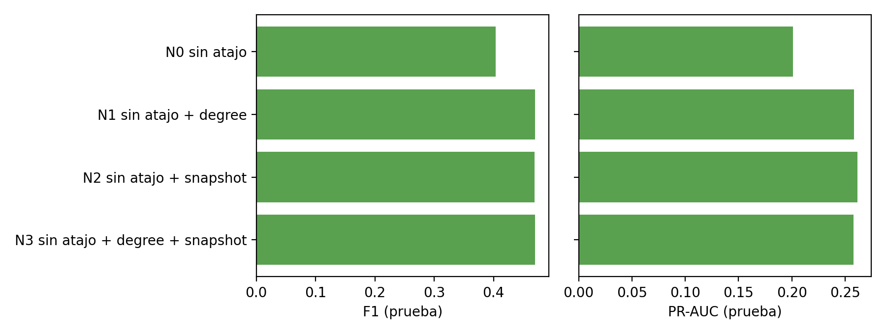
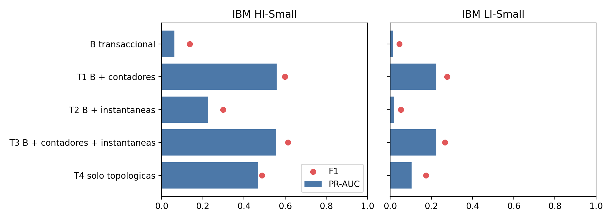
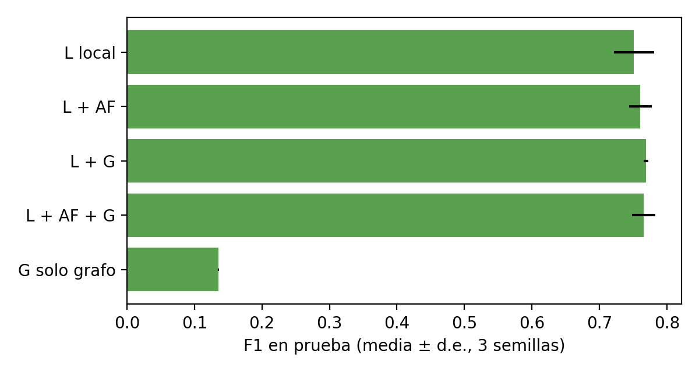
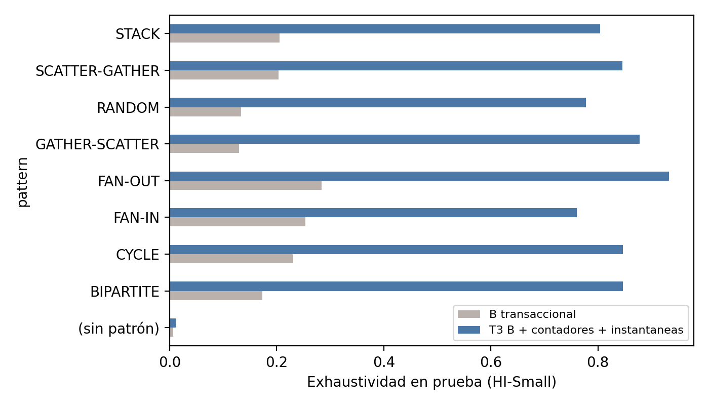
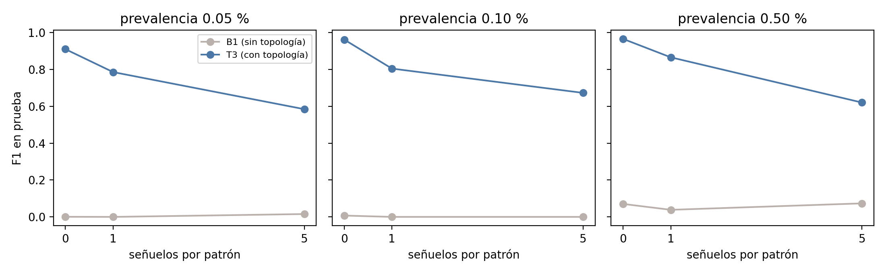

# 4. Resultados

Este capítulo reporta los resultados sin interpretarlos; la interpretación está en el Capítulo 5. Se presentan primero los del Estudio 1, en PaySim (4.1–4.4), y luego los del Estudio 2 (4.5–4.9), en el orden de las preguntas de investigación: la caracterización de los grafos, el contraste confirmatorio (P1), las réplicas (P2), la contribución de cada tipo de variable (P3) y la inyección controlada (P4). La sección 4.10 resume ambos estudios.

Todas las cifras se obtienen con los scripts de `experiments/` y se guardan en `results/`; la Tabla C.1 (Anexo C) indica qué script produce cada tabla y figura. Salvo que se indique otra cosa, las métricas corresponden al conjunto de prueba, con el umbral elegido en validación, y se reportan como media ± desviación estándar sobre tres semillas. Los intervalos de confianza (IC) son del 95 % y se obtienen por *bootstrap* pareado.

**Estudio 1: PaySim** (secciones 4.1 a 4.4)

## 4.1 Estructura del grafo de PaySim

**Tabla 4.1.** Propiedades estructurales del grafo de PaySim.

| Propiedad | Valor |
|---|---|
| Transacciones (aristas) | 6 362 620 |
| Orígenes distintos | 6 353 307 |
| Destinos distintos | 2 722 362 |
| Orígenes que aparecen en más de una transacción | 9 298 |
| Cuentas que actúan como origen y como destino | 1 769 |
| Fraudes cuyo origen aparece una sola vez | 99.66 % |
| Destinos de TRANSFER fraudulentas que luego actúan como origen | 0.20 % |
| Ciclos dirigidos | 0 |
| $\beta_0$ / $\beta_1$ del grafo no dirigido subyacente (Proposición 2.3) | 2 711 280 / 0 |

El grafo no contiene ciclos dirigidos en ninguna de las 31 instantáneas diarias, y su grafo no dirigido subyacente es un bosque ($\beta_1 = 0$): no tiene ciclos de ningún tipo. Al momento del fraude, los destinos fraudulentos habían recibido en promedio 8.1 transacciones previas.

## 4.2 Contraste de la hipótesis en PaySim

La prueba contiene 161 426 transacciones y 1 840 fraudes (prevalencia 1.14 %; PR-AUC de un clasificador aleatorio: 0.011). La Tabla 4.2 y la Figura 4.1 muestran el desempeño por configuración.

**Tabla 4.2.** Desempeño en prueba por configuración (PaySim, *Random Forest*).

| Configuración | $F_1$ | Precisión | Exhaustividad | PR-AUC |
|---|---|---|---|---|
| B0 Base (8 variables) | 0.9968 ± 0.0016 | 0.9982 | 0.9955 | 0.99998 |
| B1 B0 + comercio (9) | 0.9978 ± 0.0010 | 0.9993 | 0.9964 | 0.99999 |
| T1 B1 + grado y fuerza (15) | 0.9950 ± 0.0002 | 0.9984 | 0.9917 | 0.99993 |
| T2 B1 + instantáneas (16) | 0.9953 ± 0.0002 | 0.9987 | 0.9918 | 0.99997 |
| T3 B1 + grado + instantáneas (22) | 0.9948 ± 0.0003 | 0.9980 | 0.9917 | 0.99988 |
| T4 Solo topológicas (13) | 0.0308 ± 0.0009 | 0.0158 | 0.6469 | 0.0152 |

T3 cumple $F_1 \ge 0.80$, pero $\Delta F_1 = F_1(\text{T3}) - F_1(\text{B1}) \in [-0.0057, -0.0016]$, con $P(\Delta F_1 \le 0) = 1.0$. **El criterio del Estudio 1 no se cumple: no se rechaza H0.** Frente a B0, el resultado es el mismo ($\Delta F_1 \in [-0.0051, -0.0011]$). La diferencia entre B1 y B0 es $[0.0000, +0.0014]$.

En la ablación (semilla 42), el $F_1$ de T3 es 0.9951. Sin grado y fuerza es 0.9954; sin instantáneas, 0.9951; sin comercio, 0.9948, y sin las variables base, 0.127. T4 obtiene un ROC-AUC de 0.600. Con *gradient boosting*, B1 y T3 obtienen el mismo $F_1$ (0.947 ± 0.012 y 0.947 ± 0.015, respectivamente).

**Figura 4.1.** $F_1$ en prueba por configuración en PaySim (media ± desviación estándar).

## 4.3 Variables dominantes del modelo de referencia en PaySim

La razón monto/saldo de origen y la indicadora de fondos insuficientes concentran el 43 % y el 15 % de la importancia de B0 (Figura 4.2). Su distribución difiere fuertemente entre clases en las transacciones CASH_OUT y TRANSFER:

**Tabla 4.3.** Distribución de las variables dominantes por clase (PaySim, tipos CASH_OUT y TRANSFER).

| Variable | Legítimas | Fraudulentas |
|---|---|---|
| Razón monto/saldo de origen, mediana | 605 | 0.999998 |
| Razón monto/saldo de origen, percentiles 25–75 | 5.1 – 1 000 | 0.99999 – 1.00000 |
| Fondos insuficientes (monto > saldo de origen) | 90.1 % | 0.35 % |

**Figura 4.2.** Importancia de variables del modelo B0 en PaySim.

## 4.4 PaySim sin las variables de saldo (análisis post hoc)

La Tabla 4.4 y la Figura 4.3 muestran el desempeño al retirar esas cuatro variables.

**Tabla 4.4.** Desempeño sin monto, saldo de origen, su razón ni fondos insuficientes (PaySim, *Random Forest*).

| Configuración | $F_1$ | Precisión | Exhaustividad | PR-AUC |
|---|---|---|---|---|
| N0 Sin saldos (5 variables) | 0.404 | 0.338 | 0.500 | 0.201 |
| N1 N0 + grado y fuerza (11) | 0.470 | 0.443 | 0.499 | 0.258 |
| N2 N0 + instantáneas (12) | 0.469 | 0.443 | 0.499 | 0.261 |
| N3 N0 + ambos (18) | 0.470 | 0.443 | 0.499 | 0.258 |

Frente a N0, $\Delta F_1 \in [+0.061, +0.072]$ para N1 y N3, y $[+0.061, +0.071]$ para N2. La desviación estándar entre semillas es 0.000 en las cuatro configuraciones.

La prueba contiene 920 fraudes TRANSFER y 920 CASH_OUT. Con la semilla 42, N0 detecta los 920 TRANSFER y N3 detecta 919; ninguno de los dos detecta ningún CASH_OUT, lo que explica la exhaustividad de 0.50. Todos los falsos positivos son transacciones TRANSFER: 1 799 en N0 y 1 154 en N3. Todos los TRANSFER fraudulentos de prueba tienen un destino con saldo previo cero. Las variables topológicas más importantes de N3 son la fuerza de entrada previa del destino, el tiempo desde su última entrada y su grado de entrada previo.

**Figura 4.3.** $F_1$ y PR-AUC en PaySim sin las variables de saldo.

**Estudio 2: datos con estructura de red** (secciones 4.5 a 4.9)

## 4.5 Estructura de los grafos de IBM AML y Elliptic

**Tabla 4.5.** Propiedades estructurales de los grafos del Estudio 2.

| Propiedad | IBM HI-Small | IBM LI-Small | Elliptic |
|---|---|---|---|
| Nodos | 515 088 cuentas | 705 907 cuentas | 203 769 transacciones |
| Nodos con entradas y salidas | 167 416 | 226 593 | 111 023 |
| Nodos en ciclos (componente fuerte > 1) | 23 247 | 26 355 | 0 |
| Mayor componente fuerte | 17 075 | 17 827 | 1 |
| Cuentas ilícitas en ciclos / todas las cuentas en ciclos | 24.8 % / 4.5 % | 25.6 % / 3.7 % | — |
| $\beta_0$ / $\beta_1$ del grafo no dirigido subyacente | 114 244 / 242 796 | 160 049 / 329 961 | 49 / 30 635 |

Los valores de $\beta$ de IBM corresponden a los conjuntos recortados. Elliptic tiene una componente por periodo ($\beta_0 = 49$) y $\beta_1 > 0$ aunque no contiene ningún ciclo dirigido. En IBM HI-Small, después del 2022-09-10 quedan 1 108 transacciones, de las cuales 655 son ilícitas. La proporción diaria de ilícitas en ese tramo va del 57 % al 73 %.

## 4.6 Contraste confirmatorio: IBM AML HI-Small (P1)

La prueba contiene 1 015 448 transacciones, de las cuales 1 143 son ilícitas (prevalencia 0.11 %). La Tabla 4.6 y la Figura 4.4 muestran el desempeño por configuración.

**Tabla 4.6.** Desempeño en prueba por configuración (IBM HI-Small, *Random Forest*).

| Configuración | $F_1$ | Precisión | Exhaustividad | PR-AUC |
|---|---|---|---|---|
| B Transaccional (10) | 0.136 ± 0.007 | 0.140 | 0.134 | 0.062 |
| T1 B + contadores (22) | 0.598 ± 0.009 | 0.732 | 0.506 | 0.559 |
| T2 B + instantáneas (20) | 0.299 ± 0.014 | 0.381 | 0.246 | 0.225 |
| T3 B + contadores + instantáneas (32) | 0.614 ± 0.006 | 0.774 | 0.508 | 0.556 |
| T4 Contadores + instantáneas (22) | 0.487 ± 0.009 | 0.517 | 0.463 | 0.469 |

Para T3 frente a B:

$$\Delta F_1 \in [+0.448,\ +0.504], \qquad \Delta \text{PR-AUC} \in [+0.464,\ +0.521].$$

**Ambos límites inferiores son positivos: según el criterio definido antes de los experimentos (3.7.2), los resultados apoyan H1.** En los 1 000 remuestreos, $\Delta F_1$ y $\Delta$PR-AUC fueron positivos. Con *gradient boosting*, el $F_1$ es 0.150 ± 0.004 para B y 0.506 ± 0.025 para T3.

**Figura 4.4.** $F_1$ (puntos) y PR-AUC (barras) por configuración en IBM HI-Small y LI-Small.

## 4.7 Réplicas (P2)

### 4.7.1 IBM AML LI-Small

La prueba contiene 1 384 766 transacciones, de las cuales 791 son ilícitas (prevalencia 0.06 %).

**Tabla 4.7.** Desempeño en prueba por configuración (IBM LI-Small, *Random Forest*).

| Configuración | $F_1$ | PR-AUC |
|---|---|---|
| B Transaccional | 0.044 ± 0.002 | 0.013 |
| T1 B + contadores | 0.276 ± 0.004 | 0.225 |
| T2 B + instantáneas | 0.051 ± 0.012 | 0.020 |
| T3 Completo | 0.266 ± 0.005 | 0.225 |
| T4 Contadores + instantáneas | 0.174 ± 0.006 | 0.104 |

Para T3 frente a B, $\Delta F_1 \in [+0.196, +0.258]$ y $\Delta$PR-AUC $\in [+0.185, +0.243]$. **La réplica cumple el criterio.**

### 4.7.2 IBM AML HI-Small sin recorte temporal (sensibilidad)

Con el conjunto completo, el $F_1$ de B es 0.238 ± 0.012 y el de T3, 0.717 ± 0.006. Para T3 frente a B, $\Delta F_1 \in [+0.454, +0.499]$ y $\Delta$PR-AUC $\in [+0.509, +0.555]$.

### 4.7.3 Elliptic

La prueba contiene 16 670 transacciones etiquetadas, de las cuales 1 083 son ilícitas. La Tabla 4.8 y la Figura 4.5 muestran el desempeño medio, y la Tabla 4.9 el *bootstrap* pareado por semilla.

**Tabla 4.8.** Desempeño en prueba por configuración (Elliptic, *Random Forest*).

| Configuración | $F_1$ | PR-AUC | ROC-AUC |
|---|---|---|---|
| L Locales (93) | 0.751 ± 0.030 | 0.784 | 0.910 |
| L + AF Agregadas de vecinos (165) | 0.761 ± 0.017 | 0.790 | 0.928 |
| L + G Grafo propias (103) | 0.769 ± 0.003 | 0.781 | 0.912 |
| L + AF + G (175) | 0.766 ± 0.017 | 0.790 | 0.927 |
| G Solo grafo (10) | 0.135 ± 0.001 | 0.122 | 0.593 |

**Tabla 4.9.** *Bootstrap* pareado por semilla en Elliptic (IC 95 %).

| Comparación | Semilla | $\Delta F_1$ | $\Delta$PR-AUC |
|---|---|---|---|
| L + G frente a L | 42 / 43 / 44 | [+0.039, +0.063] / [−0.023, −0.005] / [+0.008, +0.027] | [−0.007, −0.002] / [−0.004, +0.001] / [−0.005, −0.001] |
| L + AF frente a L | 42 / 43 / 44 | [+0.038, +0.062] / [−0.023, −0.001] / [−0.021, +0.004] | [+0.004, +0.011] / [+0.004, +0.011] / [+0.002, +0.008] |
| L + AF + G frente a L | 42 / 43 / 44 | [+0.049, +0.075] / [−0.044, −0.020] / [+0.002, +0.027] | [+0.002, +0.009] / [+0.004, +0.010] / [+0.002, +0.009] |
| L + AF + G frente a L + AF | 42 / 43 / 44 | [+0.005, +0.018] / [−0.027, −0.013] / [+0.015, +0.030] | [−0.003, +0.000] / [−0.002, +0.001] / [−0.001, +0.002] |

El signo de $\Delta F_1$ cambia según la semilla en todas las comparaciones. **La réplica no cumple el criterio de forma robusta.** El $\Delta$PR-AUC de las variables agregadas frente a L es positivo en las tres semillas.

**Figura 4.5.** $F_1$ en prueba por configuración en Elliptic (media ± desviación estándar).

## 4.8 Contribución de cada tipo de variable (P3)

### 4.8.1 Ablación por grupo

**Tabla 4.10.** Ablación del modelo completo T3 en IBM (semilla 42).

| Grupo retirado | HI-Small $F_1$ | HI-Small PR-AUC | LI-Small $F_1$ | LI-Small PR-AUC |
|---|---|---|---|---|
| Ninguno (T3) | 0.607 | 0.555 | 0.270 | 0.227 |
| Transaccional | 0.481 | 0.474 | 0.169 | 0.103 |
| Contadores | 0.308 | 0.225 | 0.061 | 0.023 |
| Instantáneas | 0.592 | 0.557 | 0.274 | 0.223 |

Las variables más importantes de T3 en HI-Small son, en orden:
1. formato de pago (28.3 %);
2. repetición del par (12.5 %);
3. minutos desde la última transacción del origen (6.7 %);
4. *fan-out* del origen en 24 h (5.3 %);
5. monto pagado (4.9 %).

La repetición del par promedia 1.5 transacciones previas en las ilícitas y 7.5 en las legítimas. El cierre de ciclo de longitud 3 está presente en el 2.26 % de las transacciones ilícitas y en el 0.016 % de las legítimas.

### 4.8.2 Contadores estructurales frente a temporales (análisis post hoc)

Para evaluar la hipótesis rival R1, los contadores se separaron en diez estructurales y dos temporales (3.7.2).

**Tabla 4.11.** Contadores estructurales frente a temporales (IBM HI-Small, *Random Forest*, tres semillas; IC 95 % por *bootstrap* pareado con la semilla 42).

| Configuración | $F_1$ | PR-AUC | $\Delta F_1$ frente a B | $\Delta$PR-AUC frente a B |
|---|---|---|---|---|
| B Transaccional (10) | 0.136 ± 0.007 | 0.062 | — | — |
| B + estructurales (20) | 0.432 ± 0.002 | 0.409 | [+0.275, +0.326] | [+0.319, +0.374] |
| B + temporales (12) | 0.450 ± 0.004 | 0.373 | [+0.283, +0.342] | [+0.280, +0.337] |
| B + estructurales + instantáneas (30) | 0.459 ± 0.009 | 0.445 | [+0.290, +0.345] | [+0.350, +0.405] |
| T3 Completo (32) | 0.602 ± 0.008 | 0.563 | — | — |

Frente a B + estructurales, el modelo completo obtiene $\Delta F_1 \in [+0.141, +0.186]$ y $\Delta$PR-AUC $\in [+0.126, +0.176]$. El $F_1$ de T3 en esta corrida (0.602) difiere del de la Tabla 4.6 (0.614) porque el orden de las columnas cambia el muestreo aleatorio de variables del *Random Forest*.

### 4.8.3 Exhaustividad por tipo de patrón

La Tabla 4.12 y la Figura 4.6 desglosan la exhaustividad por tipo de patrón.

**Tabla 4.12.** Exhaustividad en prueba por tipo de patrón de lavado (IBM HI-Small, semilla 42).

| Patrón | Transacciones en prueba | B | T3 |
|---|---|---|---|
| *Fan-out* | 74 | 0.28 | 0.93 |
| *Gather-scatter* | 147 | 0.13 | 0.88 |
| Ciclo | 65 | 0.23 | 0.85 |
| Bipartito | 52 | 0.17 | 0.85 |
| *Scatter-gather* | 123 | 0.20 | 0.85 |
| *Stack* | 107 | 0.21 | 0.80 |
| Aleatorio | 45 | 0.13 | 0.78 |
| *Fan-in* | 71 | 0.25 | 0.76 |
| Sin patrón listado | 459 | 0.01 | 0.01 |

El cruce con el archivo de patrones es exacto: las 3 209 transacciones listadas coinciden con transacciones ilícitas y ninguna legítima queda asociada a un patrón.

**Figura 4.6.** Exhaustividad por tipo de patrón en IBM HI-Small.

## 4.9 Inyección controlada (P4)

La Tabla 4.13 reporta los nueve escenarios de la inyección, y la Figura 4.7 muestra cómo cambia el $F_1$ con los señuelos.

**Tabla 4.13.** Desempeño con fraude estructurado inyectado en PaySim (*Random Forest*, semilla 42; IC por *bootstrap* con 500 remuestreos).

| Prevalencia | Señuelos | Positivos en prueba | $F_1$ B1 | $F_1$ T3 | $\Delta F_1$ (IC 95 %) | Exhaustividad T3: cadena / ciclo / *fan-in* |
|---|---|---|---|---|---|---|
| 0.05 % | 0 | 76 | 0.001 | 0.910 | [+0.857, +0.952] | 1.00 / 0.76 / 1.00 |
| 0.05 % | 1 | 96 | 0.000 | 0.786 | [+0.725, +0.843] | 0.92 / 0.64 / 0.98 |
| 0.05 % | 5 | 95 | 0.016 | 0.585 | [+0.490, +0.635] | 0.75 / 0.73 / 0.94 |
| 0.10 % | 0 | 226 | 0.007 | 0.962 | [+0.936, +0.972] | 0.99 / 0.76 / 1.00 |
| 0.10 % | 1 | 193 | 0.000 | 0.805 | [+0.760, +0.840] | 0.88 / 0.65 / 0.97 |
| 0.10 % | 5 | 173 | 0.000 | 0.673 | [+0.619, +0.722] | 0.76 / 0.75 / 0.88 |
| 0.50 % | 0 | 901 | 0.070 | 0.966 | [+0.885, +0.907] | 0.97 / 0.76 / 0.98 |
| 0.50 % | 1 | 911 | 0.038 | 0.866 | [+0.806, +0.848] | 0.86 / 0.67 / 0.96 |
| 0.50 % | 5 | 870 | 0.073 | 0.620 | [+0.524, +0.569] | 0.74 / 0.70 / 0.90 |

El $F_1$ de B1 es como máximo 0.073 en los nueve escenarios. El de T3 es 0.91–0.97 sin señuelos, 0.79–0.87 con un señuelo por patrón y 0.59–0.67 con cinco. Entre los tres patrones, la exhaustividad más baja corresponde a los ciclos en los nueve escenarios (0.64–0.76).

**Figura 4.7.** $F_1$ en prueba frente al número de señuelos por patrón, para cada prevalencia.

## 4.10 Resumen de resultados

La Tabla 4.14 resume el contraste en cada conjunto.

**Tabla 4.14.** Resumen del contraste en cada conjunto.

| Conjunto | Rol | $F_1$ referencia | $F_1$ con topología | ¿Criterio cumplido? |
|---|---|---|---|---|
| PaySim | Estudio 1 | 0.998 | 0.995 | No (diferencia negativa) |
| IBM HI-Small | Contraste confirmatorio | 0.136 | 0.614 | Sí |
| IBM LI-Small | Réplica | 0.044 | 0.266 | Sí |
| IBM HI-Small sin recorte | Sensibilidad | 0.238 | 0.717 | Sí |
| Elliptic | Réplica | 0.751 | 0.766 | No robusto |
| PaySim con inyección (9 escenarios) | Prueba de capacidad | ≤ 0.073 | 0.585–0.966 | Sí, en los 9 |
